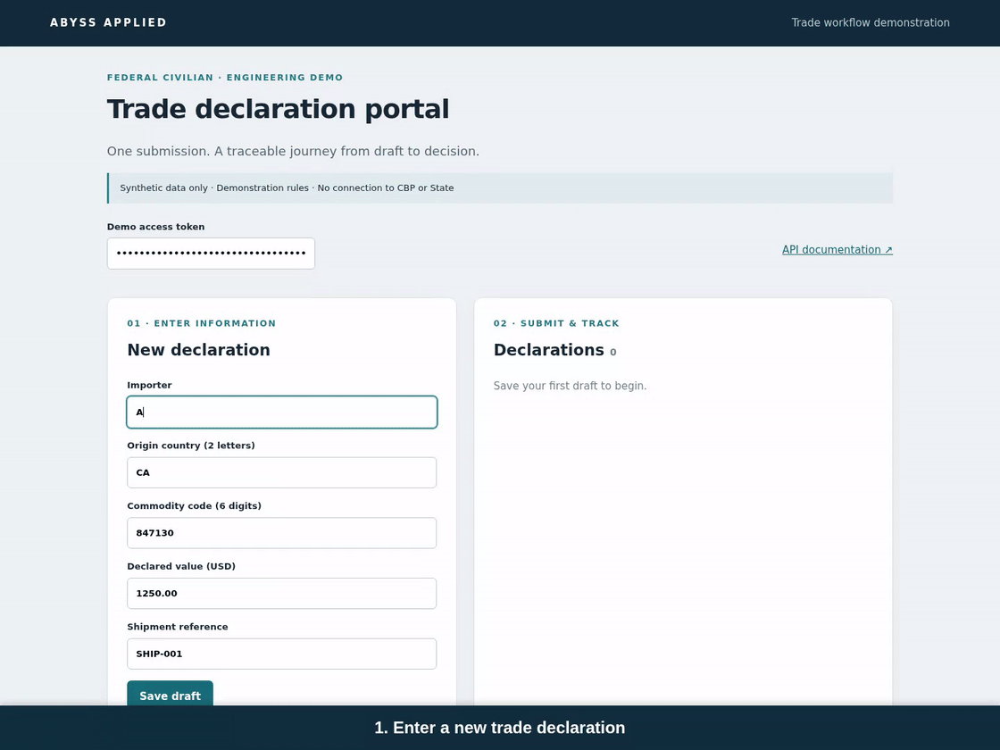
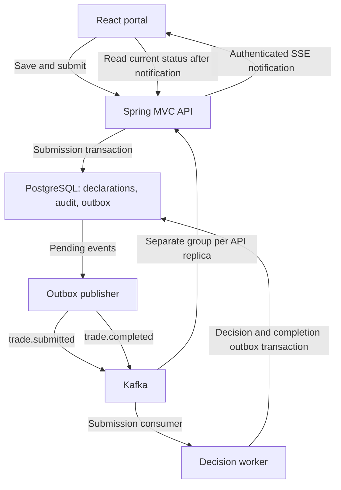

# abyss-trade-workflow

A trade declaration demo with **Go and Java implementations**, React portals, PostgreSQL transactional outboxes, and Kafka. The Java 25 edition uses Spring MVC with virtual threads and authenticated SSE status notifications. The Go baseline uses goroutines and browser polling.

Create a draft, submit it, and watch a background worker accept or reject it. The Java portal keeps one persistent status subscription. PostgreSQL holds the authoritative declaration and audit history.



Java demonstration: save a draft, submit it, and watch the decision and audit trail update through SSE after the worker resumes. [Watch the video](docs/media/trade-workflow.mp4).

## Run

Requires Docker Compose. Stop an older trade demo first because the host ports are shared.

```bash
./demo java  # Java completion events + SSE
# Or, after stopping Java:
./demo go    # Go baseline
```

Open **http://localhost:13000** and enter the token generated in `implementations/java/.env` or `implementations/go/.env`. Save a draft, then submit it. API health: http://localhost:18080/health. Interactive docs: http://localhost:18081.

```bash
cd implementations/java  # or implementations/go
docker compose logs -f api publisher worker
docker compose down  # retain database and Kafka data
```

Java uses Compose project `abyss-trade-java-events`; Go uses `abyss-trade-mnt`. Their database and Kafka volumes are separate. Run one edition at a time because host ports are shared. No Java or Node installation is needed to run the container demo. Data and rules are synthetic. The threshold rule accepts declarations up to $100,000 and rejects larger values.

## Implementations

| Edition | Source | Status delivery |
|---|---|---|
| Go baseline | [implementations/go](implementations/go/README.md) | API reads PostgreSQL; React polls |
| Java event edition | [implementations/java](implementations/java/README.md) | API consumes Kafka completion events; React subscribes over SSE |

Both include their own backend, React frontend, Docker Compose stack, SQL schema, OpenAPI contract, and smoke checks. The difference in delivery scope is explicit; this is not an equivalent performance benchmark.

## Java event architecture



The submission and its event commit together. The worker commits the decision, audit entry and completion event together. A publisher forwards both event types to Kafka and marks delivery after broker acknowledgment. Each API replica consumes completion events and notifies its own browser connections.

SSE carries a change notification. React then reads current status and audit history. Heartbeats keep the connection open without repeated status requests. Reconnect refreshes a snapshot. This delivers current state, rather than a durable per-browser replay of every transition.

## Reliability boundaries

| Scenario | Behavior |
|---|---|
| Repeated submit for one declaration ID | Row locking permits one submission transition and event |
| Redelivered submission event ID | Event marker and decision commit together, avoiding another decision |
| Worker stops after submission | Kafka retains the submission for processing after restart |
| Kafka publication fails | The event stays pending in the outbox |
| Browser reconnects | It reads the current PostgreSQL snapshot |
| Save identical form data as separate drafts | Both create new IDs. Business uniqueness has not been defined |

## Verification

```bash
make verify EDITION=java  # Java, frontend and live Compose smoke checks
make verify EDITION=go    # Go and frontend checks
```

Java checks passed 15 tests and frontend checks passed 16 tests, plus packaging, lint and build. A live Java/PostgreSQL/Kafka browser run verified worker recovery, one persistent SSE subscription, no idle status polling, and one submission/decision audit trail. CI checks both implementations. Multi-replica operation and capacity remain unverified.

No benchmark establishes connected-user capacity or a Go/Java performance winner. The demo uses a shared local identity, illustrative rules and synchronous notification fan-out. Production needs real identity and authorization, bounded delivery/backpressure, a deliberate consumer-group lifecycle, and workload/recovery testing. Kubernetes files are starter manifests, not evidence of a live cluster deployment.

## Technical briefing

- [Architecture and event distribution](docs/architecture.md)
- [Go and Java tradeoffs](docs/go-vs-java.md)
- [Requisition mapping](docs/requirements.md)
- [Verification and limitations](docs/verification.md)
- [PowerPoint briefing](docs/briefing.pptx)
- [Local setup and recovery commands](docs/local-demo.md)

Both implementations are included. Go is the earlier architectural baseline; Java is the completion-event and SSE edition. React is the browser layer, while virtual threads handle Java request execution.

## License

[MIT](LICENSE) — Copyright © 2026 Abyss Applied LLC.
